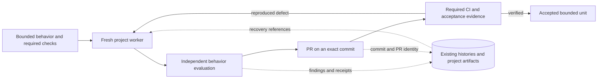

# Long-running harness: performance, acceptance, and recovery

Research review, 2026-10-26. Runtime source audited at `168fb1b1fa02bde81001d51c4eb60fbf82962635`. Trial task/usage snapshot: 22:18:36 UTC; exact-head CI observations: 22:27:33–39 UTC. Controlled recovery probes: 22:32 UTC.

The trials now produce PRs and perform substantive delegated work. They do not yet demonstrate reliable acceptance or a causal efficiency gain. The strongest next improvements are to identify missing test inputs before repeated review, measure useful reviewer findings, reduce redundant context/status traffic, and prove recovery without duplicate execution. No production model, review count, permissions, or lifecycle policy was changed for this analysis.

## What the two articles establish

[Harness design for long-running application development](https://www.anthropic.com/research/harness-design-long-running-apps) presents evaluator-guided application builds with observable acceptance conditions. Its context-reset findings differ by model; later experiments simplify the workflow as capabilities change. The comparisons also change scope, compute, task, or model, so they do not isolate a transferable efficiency gain. Evaluator scores sometimes diverged from the author's preferences. Its practical contribution is a design hypothesis: agree on observable behavior, separate construction from evaluation, and remove coordination that no longer earns its cost. It does not establish the right reset schedule or reviewer count for our Sol configuration. All chapters, tables, qualifications, and appendix were read. Current linked prompts/skills are not a pinned reproduction of historical runs; article modification metadata alone cannot establish what text changed.

[Scaling Managed Agents](https://www.anthropic.com/research/managed-agents) separates durable history, the decision loop, and execution environments. Replaceable components and selective history retrieval support recovery; optional execution environments can be created when needed. Credential separation is structural. Its reported startup gains concern its former container-provisioning path, which our CLI does not have. The relevant transfer is stable recovery interfaces around existing stores, not a hosted-platform rewrite. The linked [event API](https://platform.claude.com/docs/en/managed-agents/events-and-streaming) separates reconnectable history from a live stream; event deduplication does not guarantee exactly-once external effects.

These are primary-source engineering accounts, not independently reproduced benchmarks for this harness. Their model-specific observations must be tested here. The proposals below are our analysis of local code and trials, not Anthropic recommendations for this deployment.

## What happened in the fresh trials

Project labels are anonymized. Private traces, prompts, repository identifiers, and exact PR locators remain outside this public note.

| Observation | Go parity trial | Rust research trial |
| --- | --- | --- |
| First worker after controller creation | 2m 09s | 4m 00s |
| Owned attempts in snapshot | 13: 12 delivered; 1 startup failure | 11: 10 delivered; 1 still running |
| Delivered worker outcomes | 11 completed; 1 failed Git setup | 10 completed |
| First PR publication | 18.4 min; packages prior accepted source | 93.1 min; new reporting change |
| PRs observed | Two open; neither merged | One open; not merged |
| Exact-head automated checks | Earlier PR red; later PR green | No checks reported |
| Remaining acceptance | Full numerical/lifetime, caller and scientific qualification open | New reporting execution and designated input qualification open |
| Review/audit elapsed worker-minutes, summed | 45.37 across seven deliveries | 46.62 across seven deliveries |

The Go controller ended its final recorded turn after 73.34 minutes. The Rust controller remained active. A delivered task is not a passing review, a PR is not verified behavior, and turn completion is not completion of the original project goal.

The earlier Go PR's failed CI reports incompatible Go versions and host-specific filesystem/compiler assumptions. The later PR is green. A local pass on a restored source link therefore cannot substitute for checking the published commit in its actual CI environment. The Rust trial has release/selected-test receipts, but those do not establish that the newly added reporting scenarios ran. An absent GitHub check alone is not a failure: equivalent required evidence can come from a declared maintained recipe.

### Where time and context went

- The Rust trial needed three paired review rounds plus a comment audit. Both reviewers found the same two gaps in round one, the same endpoint-test defect in round two, and no new source findings in round three. The corrections were useful. No unique additional defect from the second member of either pair was established in this sample; corroboration is not proof of waste. The missing execution input remained unresolved throughout those rounds.
- The Rust controller submitted 67 status commands across 57 JavaScript invocations, 62 yielded-session resumes across 58 invocations, and 14 queued coordination commands across 12 invocations. These overlap; they are not independent model-turn counts. The Go controller also resumed waits frequently. Persistent `horch wait` already polls internally without invoking a model. Additional pane reads should earn their context cost by resolving an actual question.
- Current controller/worker tool-output truncations were 10/49 for Rust and 6/23 for Go. Large combined instruction, report, and status reads are clear context-pressure candidates. Full instruction reads required by a workflow still need to happen; avoid repeating them in the same process and retrieve bulk evidence selectively afterward.
- The Go packaging worker spent 11.27 elapsed minutes before delivering a failed Git-metadata operation. Its controller continued shipping. A separate bootstrap failure was preserved and retried in a fresh process. This recovery worked without observer coordination, but setup mismatches consumed work.

Cumulative input telemetry is mostly cached: the Rust controller recorded 34.28M input tokens, including 33.75M cached; its workers recorded 33.94M, including 32.65M cached. Go recorded 21.22M/21.00M controller input/cached and 14.29M/13.26M worker input/cached. Cached input is a subset, not extra input. These are repeated API inputs, not distinct source text. No monetary or causal speedup claim follows. Status work overlaps worker execution, so removing it cannot be assumed to shorten the critical path by its apparent duration.

## Changes most likely to help

### 1. Freeze acceptance before implementation

Use the existing project brief to name the bounded behavior, exact revision/input identities, maintained checks, and required result. Resolve genuine test-input availability with that recipe early. This is execution evidence, not a new heuristic cache gate or another permission ceremony.

Keep three facts distinct: source review, required behavior exercised, and PR/CI delivery on the pushed commit. Source-only work can be published honestly while runtime acceptance remains blocked. Do not label an unexecuted feature verified, and do not let another source review stand in for the missing run. A new prerequisite must trace to the agreed requirement or a demonstrated defect; otherwise queue it as a separate unit.

The completion contract should require the relevant checks for the exact published head, or an explicit baseline/environment blocker. It should not demand the entire long-term scientific goal before any bounded source PR can ship.

### 2. Improve review yield before adding reviewers

Have findings identify the violated criterion, exact code/input identity, and a reproducible observation. Distinguish a runtime defect, a coverage gap, a missing input, and an optional improvement. After a correction, review the affected delta plus its integration boundary; reuse unchanged accepted evidence when its identities remain valid.

Give the behavior evaluator the acceptance contract and revision, and have it record observations before reading the writer's self-evaluation. Calibrate it with known-bad changes and held-out correct cases.

Keep the configured release review unchanged initially. In a shadow evaluation, compare one independent behavior evaluator with the existing pair on completed changes and known-defect controls. Measure unique reproduced defects, false approvals, unresolved acceptance, worker minutes, and tokens. Separate processes using one model family are not statistically independent error sources.

### 3. Reduce coordination without weakening ownership

The project controller owns the unit through correction, verification and PR delivery. Give workers source changes and focused checks. Where the sandbox cannot write shared Git metadata, the controller performs the authorized commit/push operation from the verified delta; do not discover this after a long packaging assignment or widen permissions automatically.

Use workspace-scoped inventory and one persistent wait process. Read a pane on an error, a material milestone, or a user status request, rather than maintaining a second routine status loop. Existing project checkpoints should link history and bulk receipts; they should not accumulate repeated permission prose. Record uncertainty once and block only dependent work. No project reports or context should be forwarded to the harness observer.

## Durability: reuse the stores, test the gaps

Codex already retains conversation history outside active context, and `horch` retains task/nonce, brief, execution location, state and result. Existing locks, atomic replacement, completion evidence and nonce checks are useful. They are not a complete crash-recovery protocol. Native storage is observed here; its power-loss guarantees and internal-format stability were not established.

Controlled exception injection against the real startup/evaluation functions, using temporary files and fake Herdr responses, demonstrated:

1. Loss before the fake service accepted a prompt and loss after acceptance but before acknowledgement persistence left identical `running` snapshots. Fake accepted counts were zero and one respectively. Recovery cannot infer whether to repeat work from that snapshot alone.
2. A matching valid result plus idle status remained `running` when completion sequence and persisted working observation were absent. With a newer completion sequence, the evaluation returned `done`. This conservatively avoids a false pass, but the missing-sequence path can remain unresolved after controller loss.
3. Ten subsequent unchanged working-state polls caused ten atomic state-file replacements with identical final bytes. This is an IO opportunity, not measured latency or throughput improvement.

These are source-level simulated boundary failures, not OS-kill, live-service, power-loss or production-incident tests. No project process was interrupted. The audited implementation is [pinned here](https://github.com/Jakeelamb/herdr-pstack-orchestrator/blob/168fb1b1fa02bde81001d51c4eb60fbf82962635/skills/herdr-orchestrator/scripts/horch.py): `write_json`, `_start_task_locked`, `turn_ended`, and `poll_round` are the relevant seams.

First test recovery using existing identities and records. If more persistence is needed, retain only the missing launch intent/observation and native execution identity. Do not assume such markers make an external RPC exactly once. An uncertain accepted command must be reconciled, not blindly replayed. A pane is a location, not a durable assignment identity. One task store per Herdr server is already the documented topology, not a new missing feature.

Prove process-death recovery before making host power-loss claims. Atomic rename does not provide file/directory flushing. If stronger disk durability is required, measure transition-only writes and flushing at meaningful boundaries; blindly adding `fsync` to every unchanged poll is the wrong first step. Missing/corrupt evidence must remain unknown rather than being promoted to success.

Worktrees isolate edits, not credentials. Keep publication with the authorized project executor and inspect actual worker access with dummy canaries before making a secret-isolation claim. No real credentials were read or tested here. A new vault, database, event bus, or distributed scheduler is not justified by these two articles.

## Stable boundaries, existing components

A project with an agreed specification already has planning in its controller, fresh writers, and configured reviewers. Adding a permanent planner or another Root approval layer is not justified. Architectural exploration can remain a bounded task when the problem actually needs it.

This is a logical view, not a proposal for new services:

Keep session history, task attempts, execution location, and acceptance evidence distinct. A compact current project checkpoint should reference them, allowing replacement of a controller without importing the full transcript or depending on the observer. Refresh actual resource ownership at pickup; preserve real locks rather than resurrecting historical advisory holds.

## Bounded experiment order

1. **Offline recovery matrix:** before/after prompt acceptance; lost acknowledgement; waiter restart with a live child; missing/corrupt state; partial result; closure failure. Count prompts and side effects, preserve attempt identities, reject early/wrong-nonce results, and require no duplicate execution. Use disposable fixtures and existing test seams.
2. **Acceptance/portability pilot:** a small Go and Rust unit with fixed commands and inputs, checked in the same environment as its delivery target. Discover unsupported test prerequisites before review. Measure time to required behavior and exact-head verification, not just PR creation.
3. **Shadow review/context ablation:** change one factor at a time with the current Sol configuration held fixed. Two alternating pilot pairs can validate the protocol; require at least five interleaved matched pairs and a blind final acceptance check before an efficiency ranking. Include failures, unresolved outcomes, cold setup, repair and review costs. Try compaction versus a fresh bounded handoff only when an observed context failure warrants it; do not impose timed resets.

The decisive metrics are time and tokens per accepted original requirement, unique defects found, escaped failures, recovery without replay, and acceptance still blocked. We have useful observational evidence and two controlled local probes; we do not yet have a benchmark that establishes a universal faster policy.

## Evidence and scope

Private measurement artifacts retain exact controller/task identities, source-prefix hashes, delivered-result nonce checks, per-response usage deduplication, the rerunnable extractor, CI observations and probe code/results. Public data here is anonymized and aggregate. Active tasks contribute partial telemetry; their unfinished results were not consumed. Review categorization uses brief/report evidence and remains an analysis heuristic. Earlier and fresh trials differ in scope, inherited work, authorization and concurrency, so they are not matched before/after experiments. No analyzed task was interrupted or producer replayed. After freezing the observation cohort, one idle project controller was relaunched under the existing authorization to continue fresh project-owned trials; that subsequent continuation is outside the measured cohort. Active work in the other project was left alone.
